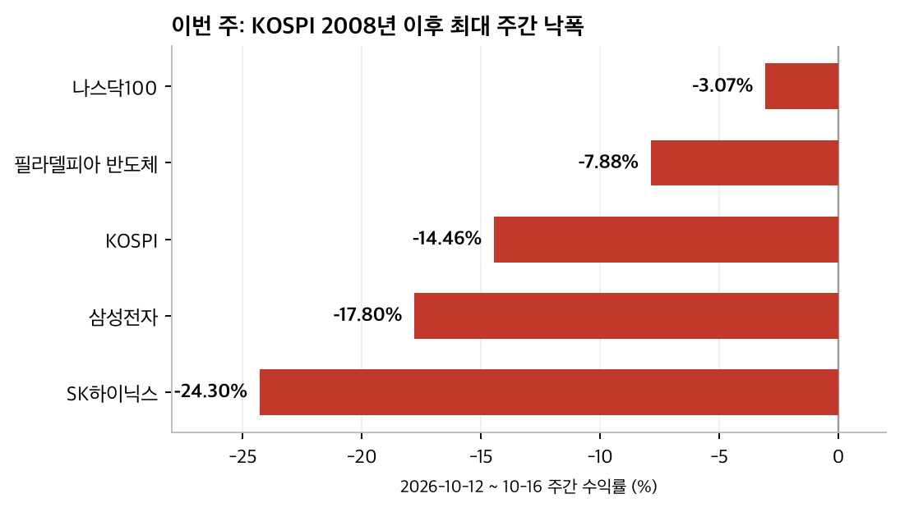
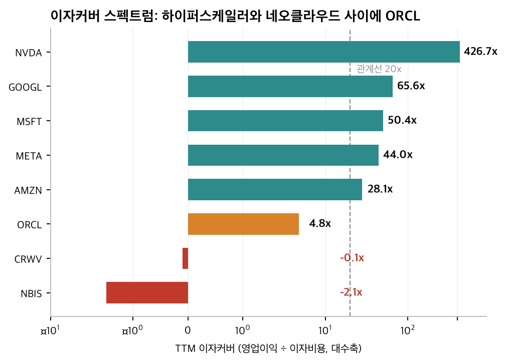
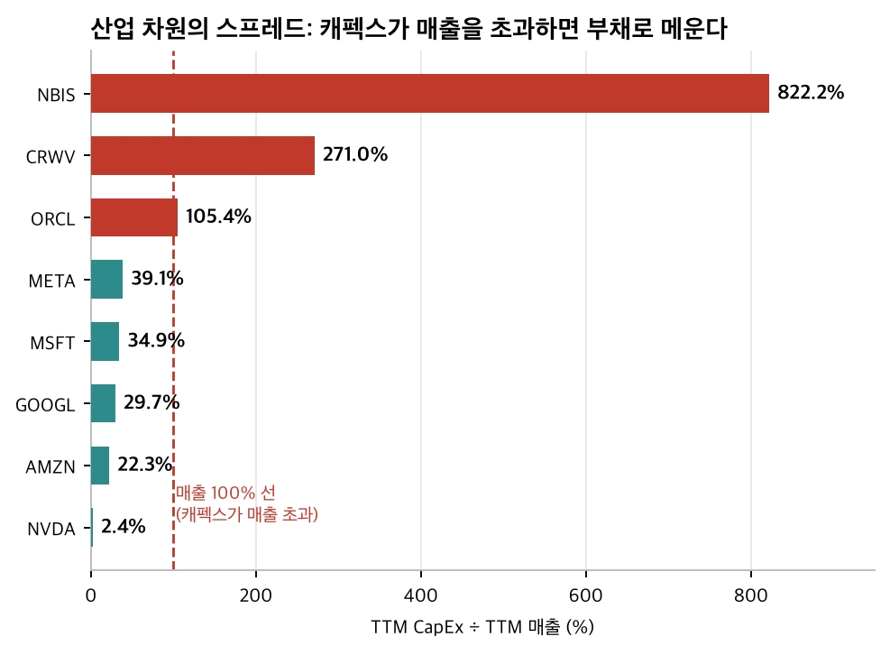
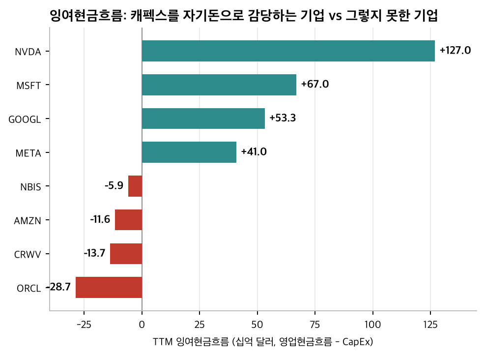
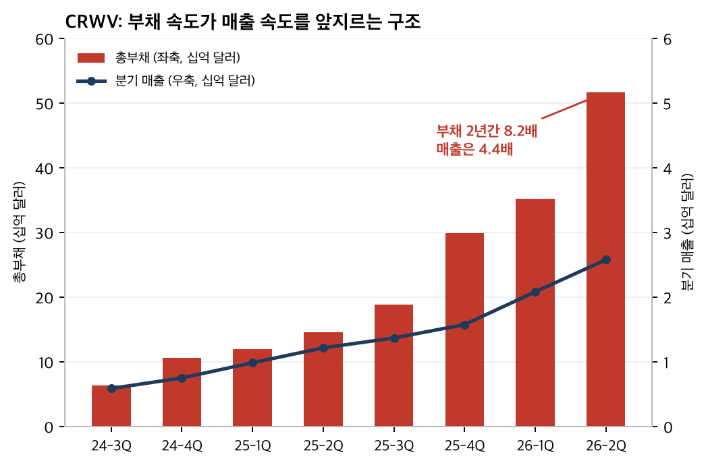
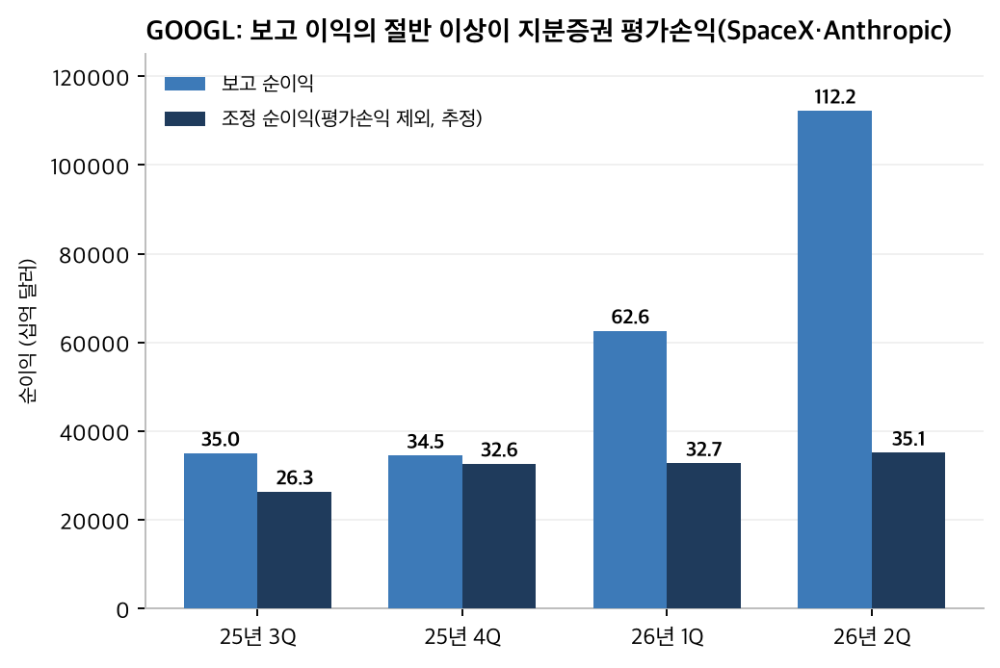
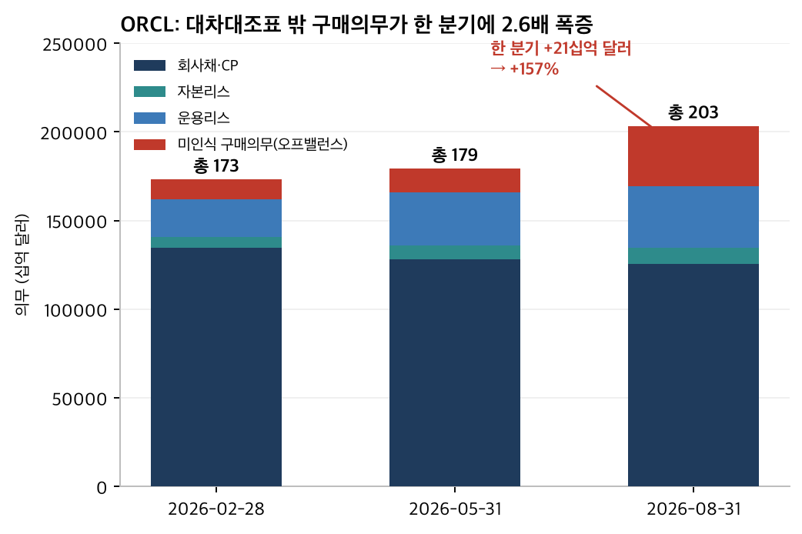
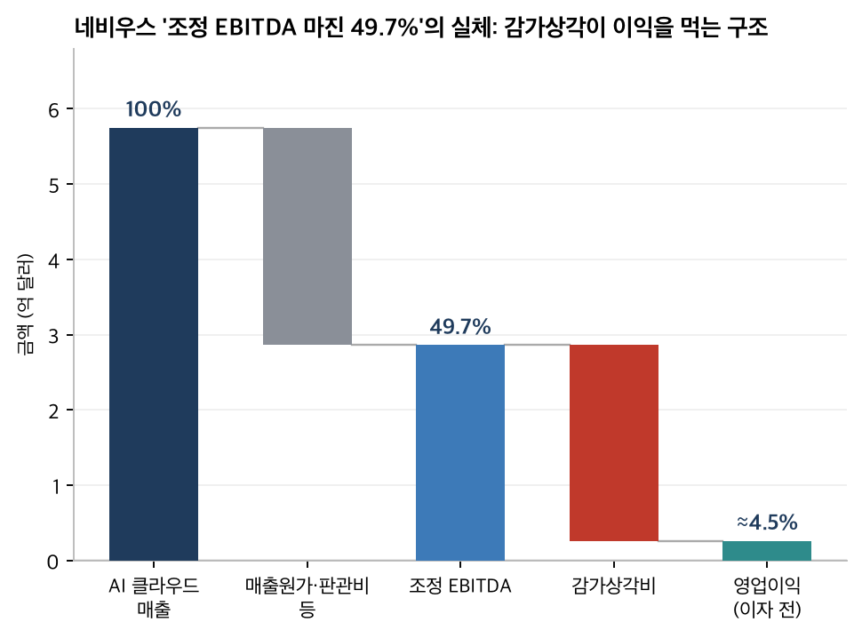

# AI 신용위기 관찰 리포트

**작성일**: 2026년 10월 17일 | **국면**: KOSPI 주간 -14.46% (2008년 이후 최대)
**리포트 작성자**: GLM 5.3 Flash NVFP4 FP4 Local 체크포인트

> 본 리포트는 공개 정보(SEC 공시 XBRL, 언론 보도)를 교차 검증하여 작성한 분석 자료입니다.
> 투자 판단 참고용이며 특정 수익률을 보장하지 않습니다.

---

## 1. 핵심 요약

1. **시장**: KOSPI가 한 주에 -14.46%(2008년 리먼 이후 최대), SK하이닉스 -24.3%. CoreWeave CDS가 1,100bp를 돌파하며 AI 신용 스트레스가 뉴스가 아니라 실제 가격에 반영되는 단계.
2. **진단**: 부채 과다 기업의 퇴출("과다한 부채를 쓴 회사의 퇴출")이 실시간으로 진행 중. 부채 속도가 매출 속도를 앞지른 기업(CRWV·NBIS)이 첫 퇴출 대상.
3. **필터**: 이자커버·FCF·캐펙스 집중도 기준으로 보면 MSFT·META·NVDA는 여유가 크고, GOOGL은 조건부(보고 이익의 상당 부분이 SpaceX·Anthropic 평가손익), AMZN은 경계(FCF 마이너스 전환), ORCL·CRWV·NBIS는 탈락.
4. **ORCL**: 오프밸런스 구매의무가 한 분기에 2.6배 폭증(110억→342억 달러). 경제적 총의무 약 2,033억 달러는 자본(672억)의 3.0배. 향후 2년간 확정 지출 약 515억.
5. **GOOGL**: 보고 PER 17.7x는 착시. 지분증권 평가손익을 빼면 조정 PER 약 34x. 다만 영업 부문(클라우드 +82%, 백로그 5,140억)은 여전히 강세.

---

## 2. 이번 주 시장

- KOSPI 주간 -14.46% (6,625.93 → 5,668.05), 10/13 하루 -7.57%로 서킷브레이커 발동
- 사상 최고 9,114.55 대비 -37.8%. 올해 상승분(+35%)은 아직 남음
- CoreWeave CDS 1,100bp 돌파 → 5년 내 부도 확률 약 63%로 시장이 평가
- CRWV 채권 수익률 약 15%, 주가 주간 급락 (10/14 하루 -15.46%)
- 미국 테크 CDS 사상 최고치, 은행들이 AI 관련 대출 매각 진행 중
- IMF 10/13 경고: AI 실망 + 고금리 + 에너지 쇼크 중첩 시 글로벌 은행 자산의 22%가 "취약" 등급

출처: [Benzinga](https://www.benzinga.com/markets/equities/26/10/62414195/kospi-worst-week-since-2008-sk-hynix-samsung-ai-selloff), [CNN](https://www.cnn.com/2026/10/16/investing/tech-stocks-ai-coreweave), [머니투데이](https://www.mt.co.kr/en/stock/2026/10/17/2026101616124556690), [Reuters](https://www.sacbee.com/news/business/article317633192.html)

---

## 3. 진단 프레임

| 프레임 개념 | 현재 사태에서의 실체 |
|---|---|
| 과다한 부채를 쓴 회사의 퇴출 | CRWV: 부채 516억 달러, D/E 10.3배, 이자커버 음수, 이자가 매출의 25%. 퇴출 경로 진행형. NBIS는 소형판. |
| 가수요의 전형 | 엔비디아가 CRWV의 미판매 용량을 2032년 4월까지 전량 매입하는 백스톱. 고객=투자자=매출보증자인 순환 구조. |
| 공급 분석이 수요 예측보다 우선 | AI 인프라 지출 2026년 1조 달러 + 2027~30년 6조 달러가 이미 주문·착공으로 확정. 반면 회수에는 연 1.5~2.5조 달러 매출 필요. |
| 강제성: 비용 = 매출 이원화 | 비용 강제: 네오클라우드·AI 채권 보유자. 기회: 자기자본 캐펙스 하이퍼스케일러, 전력(강제성 1순위 산업), 구조조정 생존자. |
| 사전 준비의 중요성 | 하락 국면에서 할 일은 매수가 아니라 분석이다. 관찰 대상과 판정 기준을 하락 전에 확정한다. |

---

## 4. 8개 기업 재무 스크린

TTM(최근 4분기 합산) 기준. 단위: 십억 달러. 이자커버 = TTM 영업이익 ÷ TTM 이자비용.

| 기업 | TTM 매출 | 이자커버 | 순부채/EBITDA | TTM FCF | CapEx/매출 | 판정 |
|---|---|---|---|---|---|---|
| NVDA | 303.0 | 426.7x | -0.12x (순현금) | +127.0 | 2.4% | 통과 |
| MSFT | 331.8 | 50.4x | 0.27x | +67.0 | 34.9% | 통과 |
| GOOGL | 445.9 | 65.6x | -0.70x (순현금) | +53.3 | 29.7% | 조건부 통과 |
| META | 228.2 | 44.0x | 0.20x | +41.0 | 39.1% | 통과 |
| AMZN | 775.7 | 28.1x | 0.76x | -11.6 | 22.3% | 경계 |
| ORCL | 71.8 | 4.8x | 3.84x | -28.7 | 105.4% | 탈락 |
| CRWV | 7.6 | 음수 | 12.25x | -13.7 | 271.0% | 탈락 |
| NBIS | 1.4 | -2.1x | 8.42x | -5.9 | 822.2% | 탈락 |

### 4.1 이자커버 스펙트럼

하이퍼스케일러(28~66x)와 네오클라우드(음수) 사이에 ORCL(4.8x)이 유일한 중간층입니다. 신용시장이 ORCL을 다음 순서로 지목하는 것은 감정이 아니라 이 수치의 반영입니다.

### 4.2 CapEx/매출: 산업 차원의 스프레드

캐펙스가 매출을 초과하면(100% 선 위) 그 차액은 부채·리스·구매의무로 조달됩니다. 하이퍼스케일러는 22~39%로 자기자본 감당 범위 안에 있지만, ORCL은 105%, CRWV 271%, NBIS 822%입니다.

### 4.3 잉여현금흐름

- 양성 4개사: NVDA +1,270억, MSFT +670억, GOOGL +533억, META +410억 달러 — 캐펙스를 자기돈으로 감당
- 음성 전환: AMZN -116억 (TTM 최초 마이너스), ORCL -287억 (TTM 매출의 40%)
- 네오클라우드: CRWV -137억 (매출 76억의 1.8배), NBIS -59억 — 캐펙스 전액을 부채로 조달 중
- 판정 기준: FCF 마이너스 + 채권 의존 = 위기 시 신용 사건 직결. FCF 양성 + 부채 여유 = 밸류에이션 압축만 부담

---

## 5. CRWV·NBIS: 퇴출 경로 진행형

- CRWV: 부채 2년간 82억→516억 달러(8.2배), 분기 매출은 4.4배 — 부채 속도가 매출 속도를 앞지름
- D/E 10.3배, 이자커버 음수, 순부채/EBITDA 12.25배 — 부채 과다 퇴출 스펙 그대로
- 고정비 데이터센터(영업 레버리지) + 부채 레버리지의 이중 레버리지: 매출 정체 시 손익 비선형 악화
- 엔비디아 백스톱(2032년 4월까지 미판매 용량 전량 매입)은 가수요 구조의 핵심 증거
- 판정: 턴어라운드 후보가 아니라 "생존 미확정" 대상
- 구조적 근거 추가 (8절): 위로 고정된 공급 비용(구매의무·자본리스), 아래로 계약 만기 후 디플레이션된 임대 가격에 놓인 "중간에 끼인 구조"
- 10-Q 원문 확인: 부채의 일부는 파산원격(bankruptcy-remote) 특수목적 연결자회사가 차입하며, 2026-06-30 기준 SPV 부채는 182억 달러의 비유동자산(주로 설비) + 26억 달러의 유동자산(매출채권·제한현금)으로 담보 설정
- 수익 모델: 매출의 98%가 take-or-pay(의무 인수) 확정계약, 고객 선급금은 계약총액의 15~25%. 다만 10-Q 자신이 "take-or-pay 모델의 지속은 보장되지 않는다"고 위험 요인으로 명시

출처: [Yahoo Finance](https://finance.yahoo.com/technology/ai/articles/coreweaves-slump-puts-spotlight-debt-131324427.html), [qz.com](https://qz.com/gpu-collateralized-debt-ai-neocloud-coreweave-financing-risks-050526)

---

## 6. GOOGL: 보고 이익의 착시와 실체

- Q2 순이익 1,122억 달러 중 지분증권 평가손익 +990억(세전). 실현 이익은 2.8억에 불과 — 종이 위의 이익
- 10-Q 노트 원문: "net gains on equity securities of $99.0 billion, primarily related to unrealized gains in our equity securities portfolio from SpaceX and a private company". 구성은 비상장주식(측정대안 회계) 미실현 +775억 + 시장가치주식(SpaceX) +217억 = 990억으로 재합산됨
- 원천: SpaceX 6월 IPO(SPCX) 재평가, Anthropic 사후평가 3,800억 → 9,650억 달러 (지분 약 14%)
- 유가증권 961억 → 1,866억 달러 급증의 재원 확인: 반기 재무활동 현금흐름 +863억 달러(대규모 채권 발행 등)를 단기 유가증권에 예치 — AI 캐펙스와 부채 상환 대비 유동성을 미리 확보 중
- **숨겨진 노출 신규 확인**: 미연결 VIE에 대한 향후 출자의무 2025년 12월 11억 → 2026년 6월 219억 달러(6개월 새 20배). 그중 200억은 특정 사기업의 운영·재무 마일스톤 조건부 자본 출자 약정(지분파생상품 처리)이며, 데이터센터 VIE에 대한 신용백스톱도 별도 제공 중
- 보고 PER 17.7x vs 조정 PER 약 34x (주가 $352 기준) — 일회성 이익의 지속성 문제("저 PER 맹신 금물") 사례
- 영업 부문은 강세 유지: 클라우드 +82%(248억), 백로그 5,140억, 2026 캐펙스 가이던스 2,050억 달러
- 위기 시 삼중 타격 구조: 멀티플 압축 + 평가손익 반전 + 포트폴리오 가치 하락. 단, 순현금 대차대조표는 여전히 최상위권

출처: SEC EDGAR XBRL (10-Q accn `0001652044-26-000071`), [Fortune](https://fortune.com/2026/07/22/anthropic-spacex-investments-google-earnings-biggest-ever-profit-quarter), [App Economy Insights](https://www.appeconomyinsights.com/p/google-the-99-billion-asterisk)

---

## 7. ORCL: 대차대조표 밖에서 부는 부채

- 경제적 총의무 2,033억 달러 = 채권 1,253억 + 운용리스 346억 + 자본리스 92억 + 미인식 구매의무 342억 (자본 672억의 3.0배)
- 미인식 구매의무: 2월 110억 → 8월 342억 (+157%/분기)
- 10-Q 노트 원문 확인: 구매의무의 성격은 "클라우드 인프라 자산 구입 부품의 장기 공급계약 + 데이터센터 전력 공급계약". 10-K에는 FY26 말 이후 클라우드 인프라 자산에 대한 **추가 190억 달러** 구매의무(5년 약정) 체결이 기재되어, 분기 폭증의 주요 원인이 이 신규 계약임이 확인됨
- 향후 2년 확정 지출 약 515억 달러: 채권 만기 399억 + 구매의무 단기분 116억 → TTM FCF -287억 상태에서 전부 재융자 필요
- 자본 확충의 정체: 2월 설정 200억 달러 ATM 주식 발행 프로그램을 1분기에 전량 사용(1.41억주, 순수입 199억 달러). 자본금 +241억의 원인이 이 증자임
- 추가 오프밸런스 보증: 특정 리스에 대해 임차인 차입금 최대 33억 달러를 보증(2026년 9월 만료)
- 생존 공식: RPO 현금화 속도 > 고정의무 서비스. RPO 6,640억 달러가 방어 자산
- 부활 조건: 구매의무 증가 정체 + RPO 지속 성장 + FCF 회복의 3가지 동시 충족

출처: SEC EDGAR XBRL (10-K accn `0001193125-26-277521`, 10-Q accn `0001193125-26-389274`)

---

## 8. 가격 디플레의 전이 구조

CoreWeave의 신용 스트레스에는 부채 이외에 두 번째, 더 느리지만 구조적인 동인이 있습니다. 바로 추론 가격의 디플레이션입니다.

**핵심 구분**: AI 사용량 증가, AI 서비스 매출 증가, GPU 사용시간 증가, 데이터센터 투자수익률은 네 개의 서로 다른 변수입니다. 매출 = 단가 × 사용량이고, GPU시간 = 작업량 × 작업당 GPU시간입니다. Multi-head Latent Attention, MoE 같은 추론 효율화 기술은 같은 GPU로 더 많은 토큰을 뽑아내므로, GPU시간 시장의 실효 공급을 늘립니다. 즉 효율 개선은 공급 증가의 한 형태입니다.

**관측치**:

| 지표 | 수치 | 측정 기간 |
|---|---|---|
| 성능 조정 AI 가격 | 약 1/1,000로 하락 | [JEP 논문](https://www.aeaweb.org/articles?id=10.1257/jep.20261506) 관측 기간 |
| 오픈소스 대 폐쇄형 가격 | 약 90% 저렴 | 같은 성능 기준 |
| Anthropic 토큰 가격 | 약 -68% | 2025년 이후 ([Reuters Breakingviews](https://www.reuters.com/commentary/breakingviews/anthropics-2-trln-dream-faces-deflation-trap-2026-10-15/)) |
| Anthropic 토큰 사용량 | 약 +90% | 2026년 3분기 |
| Anthropic 월 매출 | 약 +19% | 같은 기간 (기간 불일치 주의) |

Anthropic 데이터포인트는 사용량 증가가 가격 하락을 완전히 상쇄하지 못했음을 보여주는 탄력성 1 미만의 관측치입니다. 측정 기간이 어긋나 확정은 불가하지만, 이 패턴이 유지되면 AI 인프라 캐펙스 회수에 필요한 매출 규모에 대한 시장 기대는 하방 압력을 받습니다.

**전이 구조와 스트레스 포인트**: 디플레는 API 계층(토큰 가격)에서 시작됩니다. GPU 임대 계층은 take-or-pay 계약이 만료될 때까지 단열되어 있습니다. 따라서 실제 스트레스 포인트는 당장이 아니라 계약 만기 집중 시기(2028~2030)와 데이터센터 공급 더블링(103GW→200GW, [JLL 2026 전망](https://www.jll.com/en-uk/newsroom/global-data-center-sector-to-nearly-double-to-200gw-amid-ai-infrastructure-boom))이 교차하는 시점이며, 그때의 승부처는 계약 종료 후 GPU 잔존자산 가치입니다.

**네비우스 반증의 산술**: 구세대 GPU 신규 계약 가격이 전분기 대비 30% 이상 상승했다는 것은 가격 데이터로서 실재하는 반증이지만, 그 "조정 EBITDA 마진 49.7%"는 감가상각비(매출의 약 45%)를 제외한 수치입니다. 감가상각을 반영하면 영업이익률은 약 4.5%(이자 전)로 떨어집니다.

**판정에의 함의**: CoreWeave는 위로 고정된 공급 비용(구매의무·자본리스), 아래로 계약 만기 후 디플레이션된 임대 가격에 놓인 "중간에 끼인 구조"입니다. 신용 관점의 탈락 판정에 이 구조적 관점이 추가됩니다. 반면 자체 실리콘을 보유한 API 사업자(하이퍼스케일러)는 추론 디플레의 상대적 수혜자입니다.

---

## 9. 데이터와 방법, 한계

**방법**

- 기업 재무 수치는 분기 재무제표 데이터(제3자 가공 집계)를 1차로 사용하고, 핵심 결론에 해당하는 수치는 SEC EDGAR의 XBRL 공식 태그 값으로 원전 검증했습니다. 예: GOOGL의 평가손익은 `EquitySecuritiesFvNiGainLoss` 태그(Q2 2026 +990.31억 달러), ORCL의 구매의무는 `UnrecordedUnconditionalPurchaseObligation*` 태그 계열.
- 시장·신용 지표는 Reuters·Bloomberg 인용 보도, IMF 금융안정보고서, Gartner 추정치를 교차 인용했습니다.
- 8절의 추론 효율화·가격 디플레 분석은 별도 조사 문서(2026-10-18)의 프레임과 출처(JEP 논문, Reuters Breakingviews, JLL)를 통합한 것이며, CoreWeave 관련 수치와 98% take-or-pay 구조는 본 리포트가 10-Q 원문으로 독립 검증했습니다.
- 조정 순이익은 회사 공시 세후 영향(GOOGL Q2 +771억)과 근사 세율을 조합한 추정치입니다.

**한계**

- 10-K/10-Q 원문(HTML)을 확보해 노트를 직접 검증한 항목: ORCL 구매의무의 품목 구성(클라우드 인프라 부품 공급 + 데이터센터 전력), GOOGL 단기투자 급증 재원(재무활동 유입분의 유가증권 예치), CRWV SPV 담보 구조(182억 + 26억 달러). 이 세 항목은 추정에서 확정으로 갱신됨.
- 조정 PER은 세율 가정에 따라 달라질 수 있고, 주가 기준 시점(2026-10-09 종가 $352) 이후 변동이 반영되지 않았습니다.
- 본 리포트의 판정("통과/탈락")은 특정 시점의 재무 스크린 결과이며 미래 부도 여부를 예측하지 않습니다.

*차트 원본과 재생성 스크립트는 저장소의 `charts_ai_crisis/` 폴더와 Python 스크립트에 포함되어 있습니다.*
